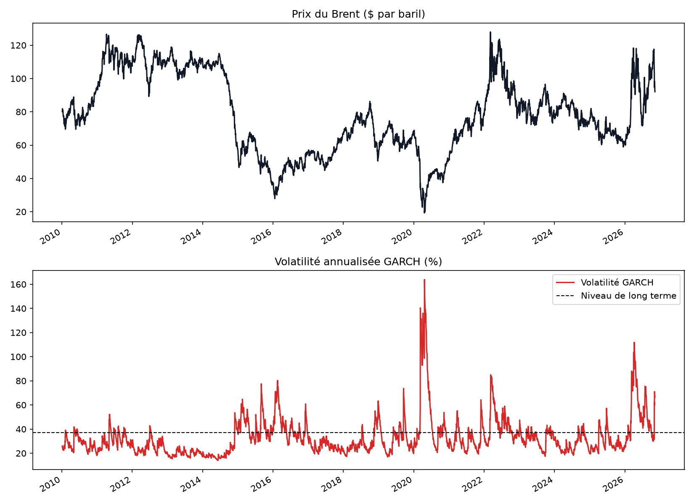
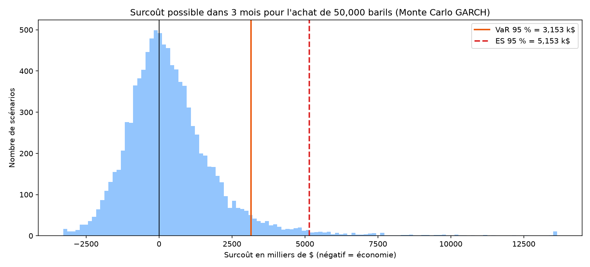

# Mesure du risque de prix du pétrole (Brent) : VaR, Expected Shortfall et stress tests

Une compagnie de transport doit acheter l'équivalent de **50 000 barils de Brent dans 3 mois** pour son carburant. Combien peut-elle perdre si le prix du pétrole monte d'ici là ?

Ce projet mesure ce risque avec trois méthodes de Value at Risk (VaR) et d'Expected Shortfall (ES), des stress tests fondés sur de vraies crises, et un backtesting du modèle.

## Données

- Prix quotidien du Brent (contrat à terme le plus proche, `BZ=F` sur Yahoo Finance) du 04/01/2010 au 09/11/2026, soit 4 208 jours
- Contrôle qualité : repérage des allers-retours aberrants (très gros saut annulé le lendemain), remplacés par interpolation

**Situation au 09/11/2026** : Brent à 92,07 $, soit un achat de **4 603 500 $** au prix du jour.

## 1. Le comportement du prix



| Indicateur | Résultat |
|---|---|
| Volatilité annualisée moyenne | 37,1 % |
| Pire jour | −28,0 % (21/04/2020) |
| Meilleur jour | +19,1 % (02/04/2020) |
| Kurtosis (excès) | 14,4 (0 pour une loi normale) |

- **Des gros chocs fréquents** : la kurtosis de 14,4 montre des queues bien plus épaisses que la loi normale.
- **Une volatilité qui change dans le temps**, modélisée par un **GARCH(1,1) avec loi de Student** : alpha = 0,087, beta = 0,903, 5 degrés de liberté. Une période agitée met longtemps à se calmer.
- **Le marché est actuellement très agité** : volatilité de **66,5 %**, contre 37,1 % en moyenne. Seul le krach du Covid en 2020 a fait plus.

## 2. VaR et Expected Shortfall sur 3 mois

Trois façons de fabriquer les scénarios de prix dans 3 mois :

- **Historique** : toutes les variations sur 3 mois réellement observées depuis 2010
- **Monte Carlo simple** : 10 000 trajectoires d'un mouvement brownien géométrique (volatilité fixe, loi normale)
- **Monte Carlo GARCH** : 10 000 trajectoires où la volatilité part de son niveau actuel et évolue, avec des chocs de Student

| Méthode | VaR 95 % | ES 95 % | VaR 99 % | ES 99 % |
|---|---|---|---|---|
| Historique | 1 564 929 $ | 2 412 261 $ | 2 913 471 $ | 3 633 206 $ |
| Monte Carlo simple | 1 575 911 $ | 2 059 312 $ | 2 344 685 $ | 2 802 186 $ |
| Monte Carlo GARCH | 3 152 666 $ | 5 153 078 $ | 6 100 559 $ | 9 055 491 $ |



**Lecture**

- **VaR 95 % historique = 1,56 million $** : dans 95 % des cas, le surcoût ne dépasse pas 34 % du prix d'achat actuel.
- **Historique et Monte Carlo simple donnent la même VaR 95 %**, mais le Monte Carlo simple sous-estime les pires cas (ES 95 % de 2,06 millions contre 2,41) : la loi normale ignore les queues épaisses.
- **Le Monte Carlo GARCH double la VaR** (3,15 millions $). Les deux premières méthodes utilisent la volatilité moyenne ; le GARCH part de la volatilité actuelle, presque deux fois plus élevée. Pour une décision prise aujourd'hui, c'est le signal le plus pertinent, mais il serait surestimé si l'agitation retombait rapidement.

## 3. Stress tests

| Scénario | Prix du baril | Surcoût |
|---|---|---|
| Brent +20 % | 110,48 $ | 920 700 $ |
| Brent +40 % (choc géopolitique) | 128,90 $ | 1 841 400 $ |
| Guerre en Ukraine (hausse max. sur 3 mois dès décembre 2021) | 150,97 $ | 2 945 117 $ |
| Pire hausse sur 3 mois hors rebond de 2020 (départ le 29/12/2025) | 175,92 $ | 4 192 500 $ |

Le rebond d'avril 2020 (Brent à 19 $ puis doublement en 3 mois) est exclu : c'est un rattrapage après un krach, qui appliqué au prix actuel donnerait un baril irréaliste à plus de 200 $.

Le pire épisode réel récent (hausse de 91 % à partir de fin décembre 2025) coûterait **4,2 millions $**, presque autant que l'achat lui-même.

## 4. Backtesting

Sur les 250 derniers jours, la perte réelle a dépassé la VaR quotidienne à 95 % du modèle GARCH **19 fois (7,6 %)**, pour 5 % attendus. Le test de Kupiec donne une p-value de **0,08** : le modèle est accepté au seuil de 5 %, mais de justesse. Il tend à sous-estimer légèrement le risque quotidien.

## Conclusion

L'achat de 50 000 barils dans 3 mois expose l'entreprise à un surcoût de **1,6 à 3,2 millions $ dans 5 % des cas** selon la méthode, et jusqu'à **4,2 millions $** si un épisode comme celui de début 2026 se reproduisait. Le choix de la méthode change fortement le résultat : en période agitée, une VaR fondée sur la volatilité moyenne rassure à tort. Face à un tel risque, une couverture (contrats à terme ou options sur le Brent) mériterait d'être étudiée.

## Limites

- **Le filtre de qualité a corrigé le 18/03/2020**, qui correspond en réalité à un vrai mouvement du krach du Covid. L'effet sur les résultats est faible, mais le filtre est imparfait sur un marché aussi volatil.
- **La persistance du GARCH (0,994) a été plafonnée à 0,99**, et la volatilité simulée ne peut pas dépasser son maximum historique (2020). Sans ces garde-fous, quelques simulations explosaient et rendaient l'Expected Shortfall inutilisable.
- **Le backtesting est limite** (7,6 % de dépassements) : le modèle sous-estime un peu le risque.
- **Les prix sont en dollars** : pour une entreprise tunisienne, le risque de change USD/TND s'ajouterait au risque de prix.
- Le contrat à terme le plus proche change d'échéance chaque mois, ce qui peut créer de petits sauts de prix.

## Lancer le projet

```bash
pip install -r requirements.txt
python risque_prix_petrole.py
```

Le script télécharge les données, affiche les résultats et enregistre les graphiques dans `figures/`. Les simulations utilisent une graine fixe : les résultats sont identiques à chaque exécution sur les mêmes données.

## Outils

Python, pandas, NumPy, SciPy, arch (GARCH), Matplotlib, yfinance
